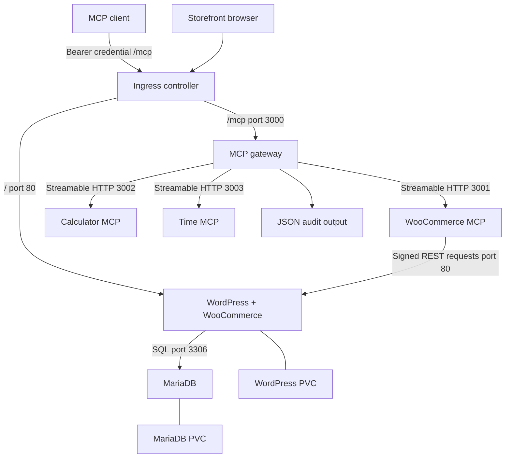
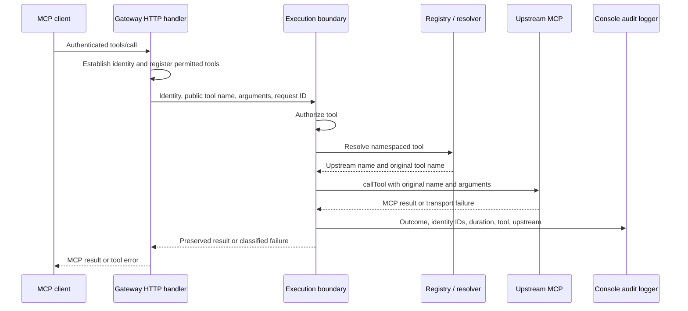

# System Design

## Scope and source baseline

Urumi is an MCP gateway and a Kubernetes-hosted WooCommerce integration. Clients use one authenticated MCP endpoint to discover and invoke tools from three upstream servers. WordPress owns storefront functionality, WooCommerce owns commerce behavior, and MariaDB stores WordPress/WooCommerce data.

This design describes [Moracus/urumi-assignment at commit `f740f55`](https://github.com/Moracus/urumi-assignment/tree/f740f557e524dd9ccf45e41014038a08a66aad92). It records implemented behavior and configuration requirements. It does not certify a running cluster or imply that the dashboard provides user, key, or server management screens. Dashboard authentication was added in #25.

See [README](../README.md) for setup and validation commands.

## Component topology

The controller is installed separately from the application chart. Internal MCP endpoints and the database have ClusterIP Services and no Ingress templates. Local values select Traefik; the chart's base ingress class is `nginx`, so deployments should explicitly choose the appropriate values file and controller namespace.

| Component | Responsibility | State |
| --- | --- | --- |
| Gateway | Authenticate requests, filter discovery, authorize calls, resolve tools, invoke upstreams, emit audit records. | MongoDB desired registrations; in-memory observed registry, cached schemas, MCP clients, refresh timer. |
| WooCommerce MCP | Validate tool inputs and translate commerce operations into REST API calls. | Environment-backed REST credentials; commerce data stays in WooCommerce. |
| Calculator MCP | Perform four arithmetic operations with bounded input types and result checks. | No persisted application state. |
| Time MCP | Format current time using an IANA timezone. | No persisted application state. |
| WordPress/WooCommerce | Storefront, products, orders, REST API, store administration. | MariaDB data and WordPress filesystem. |
| MariaDB | Persist WordPress and WooCommerce relational data. | PVC mounted at `/var/lib/mysql`. |
| Dashboard | React/Vite login, password replacement, protected account navigation and logout. | In-memory session/CSRF state; authoritative cookie session restored through same-origin APIs. Management screens remain later work. |

## Gateway initialization and discovery

`apps/gateway/src/app.ts` exports `createGatewayApp()`, which constructs the Fastify application, connects the registry, and starts discovery refresh without opening a listening socket. Its optional upstream configurations, audit logger, host, and allowed hosts let HTTP tests use controlled MCP servers while retaining the real registry and execution pipeline. Defaults supply a one-time transactional MongoDB migration for WooCommerce, calculator, and time endpoints from environment variables or cluster DNS. Startup restores persisted desired registrations and rebuilds observed connections and catalogs. Administrator dashboard sessions can inspect servers through inspection APIs, persistence-first POST registration and durable enable/disable/remove; manual refresh is available through the same serialized registry maintenance path. See [storage, migration and API contracts](upstream-registrations.md). Run a single gateway replica until runtime-change coordination exists. `index.ts` owns listening and process shutdown.

The registry connects to all upstreams independently using `Promise.allSettled`. A failed upstream does not abort initialization of healthy ones. Each connection uses the MCP client and Streamable HTTP transport. Connection setup and tool discovery each have a five-second timeout.

An upstream becomes `connected` only after a successful `listTools` response. Its cache records the discovered tool names, descriptions, and JSON input schemas. States include `disconnected`, `connecting`, `connected`, `unreachable`, and `disabled`.

The gateway refreshes discovery every 30 seconds. A disconnected or unreachable upstream is reconnected on a subsequent refresh. Failed discovery closes the connection, marks the upstream unreachable, and preserves earlier tool definitions internally. Those cached definitions are excluded from public discovery while the upstream is unavailable.

The aggregator publishes `<upstream>.<tool>` names, such as `woocommerce.list_products` and `calculator.calculate`, sorts them predictably, and rejects duplicate public names. Identical unprefixed names from different upstreams remain distinct. Input schemas are cloned and converted through the MCP server SDK for registration.

The gateway constructs an MCP server using the current catalog and request identity. It filters out tools the identity cannot invoke. Changes appear through subsequent requests and catalog construction; the code does not implement an explicit proactive tool-list-change notification mechanism.

## Authentication and authorization

Every `/mcp` HTTP request authenticates once before the SDK handler using the SHA-256 digest of its individually issued `ugw_` bearer key. MongoDB resolves the current unrevoked key and active owner with no pending password replacement. Missing, invalid, revoked, orphaned, disabled-user, and pending-password credentials receive safe HTTP 401 with `WWW-Authenticate`; authentication storage failures return bounded safe 503 responses. Bootstrap credentials, dashboard cookies, and client session identifiers never authenticate MCP. There is no outage fallback.

A request-local asynchronous scope propagates verified `AuthenticatedIdentity` (`userId`, current `role`, and `keyId`) into the existing per-request MCP factory and shared execution path. It avoids duplicate database authentication and does not introduce persistent MCP sessions or identity caching. Successful authentication advances `lastUsedAt`, even if later protocol, authorization, or execution fails. A conditional update guards concurrent revocation and never moves last use backwards. Subsequent requests from an existing connection recheck database state; already admitted operations need not be canceled. See [read-only MCP use and revocation](mcp-authentication.md).

Users and permanently consumed initial administrator setup are stored in MongoDB, with Argon2id passwords and unique normalized email. [Personal key management](api-keys.md) uses a separate dashboard cookie/session boundary. [Dashboard sessions](dashboard-sessions.md) persist hashed opaque credentials with a fixed eight-hour expiry, exact trusted Origin and session-bound CSRF for mutations, and current user eligibility/roles. Password replacement transactionally replaces the password hash, clears required replacement, and invalidates every target-user session without revoking keys. Only account details, password change, and logout permit pending replacement. Transactions coordinate rolling login throttles across gateway instances. Secure HTTPS is required unless explicit development HTTP is configured. See [identity setup](identity-setup.md) for storage and CLI behavior.

The authorization module permits admins to invoke all registered tools. Its member allowlist includes `woocommerce.list_products`, `woocommerce.list_orders`, `woocommerce.get_order`, `calculator.calculate`, and `time.current`. Product creation and order updates are rejected for members. Member behavior is exercised through real MCP SDK requests with persisted keys as well as shared execution tests.

Authorization is applied both while constructing the visible catalog and before resolving/executing a tool. This prevents an internal caller from bypassing authorization simply by naming a hidden tool. Host allowlists provide HTTP host validation; they are separate from bearer authentication and Kubernetes network controls.

## Tool execution flow

The execution boundary generates audit timing around authorization, resolution, and invocation. Its request ID is generated by the gateway tool callback, rather than copied from a client JSON-RPC ID.

The resolver maps a public name to an upstream and original name. Unknown names produce a not-found error internally. A name previously discovered on an unavailable upstream can produce an unavailable error internally; since unavailable tools are omitted from the current catalog, the SDK may reject such a public call before it reaches this resolver.

Before forwarding, the invoker checks that the upstream is enabled and connected, the original tool exists in its catalog, and the public name exactly matches the expected namespace mapping. Arguments are forwarded without adding user credentials. The client's gateway bearer token is not forwarded to upstream servers.

Upstream `callTool` has a ten-second timeout. Responses must contain a `content` array whose entries have string `type` fields. Valid MCP results are preserved, including `isError` and any `structuredContent`. A tool-level error such as division by zero is different from a broken transport and does not by itself disconnect the upstream.

For classified execution failures, the gateway callback returns a generic MCP tool error such as “Upstream server unavailable” or “Upstream request timed out.” This avoids exposing connection exceptions from the gateway. WooCommerce tool errors preserve REST status, code, and message in their result, so this is not universal redaction of upstream messages.

## Failure handling and health

Connection failures, call timeouts, failed MCP requests, and invalid response structures affect the corresponding upstream. The registry closes that connection and excludes its tools while healthy upstreams remain discoverable. Per-upstream connection maintenance is coordinated, and a failure from an older client is checked before invalidating a replacement connection.

Recovery is periodic reconnection and rediscovery, not automatic replay of the failed tool call. There is no write-idempotency mechanism. A timeout during product creation or an order update can occur after the store has applied the operation; inspect the store before retrying.

| Probe | Actual guarantee |
| --- | --- |
| Gateway `/health/live` | HTTP process responds. |
| Gateway `/health/ready` | Startup/authentication validation and required migration completed, and MongoDB responds to a bounded ping; otherwise HTTP 503. Zero connected upstreams is permitted. |
| Upstream `/health/live` and `/health/ready` | Process-level response; no WordPress API dependency check. |
| WordPress readiness | A static WordPress CSS asset is served, not a commerce transaction. |
| MariaDB readiness | Container health script checks connectivity and InnoDB initialization. |

Gateway readiness checks database availability and reports connected upstreams without requiring any, and does not verify individual keys, complete tool availability, or end-to-end WooCommerce behavior. Cached connection state can lag behind an outage until a request or discovery refresh detects it.

Startup validates MongoDB connectivity, indexes, and an actual transactional write before serving. New MCP requests fail safely with HTTP 503 during database outages; liveness remains healthy, and readiness recovers through driver reconnection. Fastify's close hook closes the MCP handler, registry, and identity database, clearing the refresh timer. Later cleanup runs even if earlier cleanup fails. The process entry point calls application close on SIGINT and SIGTERM; HTTP tests call the same close boundary directly.

## WooCommerce integration

The adapter registers two product tools and three order tools with Zod input validation. Lists return selected fields and a count for the returned page; they do not expose a total record-count abstraction. Product creation supports simple products only. Order status updates are limited to four specified statuses. Order creation, deletion, inventory workflows, and refunds are not implemented tools.

The REST client targets `/wp-json/wc/v3`, signs requests with OAuth-style HMAC-SHA1 parameters, and uses fresh nonces and timestamps. Requests have a ten-second timeout and reject redirects. HTTP status failures and invalid JSON become WooCommerce errors represented as MCP tool results.

`WC_URL` is the canonical storefront URL used to calculate the signature. When `WC_INTERNAL_URL` is set, the client rewrites only the network destination's scheme, hostname, and port after signing, and supplies the canonical `Host` header. This lets the adapter reach `urumi-wordpress` directly while preserving the expected storefront host.

The site's configured canonical URL, scheme, and port must agree with the signing URL. Redirects, port mismatches, or a site forcing HTTPS while the internal hop uses HTTP can prevent successful requests; HTTPS/proxy configuration needs explicit verification when changed.

Read/write WooCommerce credentials are supplied only to the adapter through its Kubernetes Secret. WordPress installation, WooCommerce activation, store settings, payment methods, and data provisioning remain manual configuration outside the Helm templates.

## Network boundaries

The chart preserves six ingress NetworkPolicies, enabled by default, and adds a gateway egress policy. Managed MongoDB adds a seventh workload ingress policy:

| Destination | Allowed source | TCP port |
| --- | --- | --- |
| Gateway | Pods in `networkPolicy.ingressNamespace` | 3000 |
| WooCommerce MCP | Same-namespace Pods labeled `app: urumi-gateway` | 3001 |
| Calculator MCP | Same-namespace Pods labeled `app: urumi-gateway` | 3002 |
| Time MCP | Same-namespace Pods labeled `app: urumi-gateway` | 3003 |
| WordPress | Controller-namespace Pods **or** same-namespace WooCommerce MCP Pods | 80 |
| MariaDB | Same-namespace WordPress Pods | 3306 |

Ports for the gateway and MCP services are configurable in values. Gateway egress permits narrow DNS and enabled bundled MCP destinations, plus explicit operator MongoDB/API/additional approvals. Other workloads retain unrestricted egress. External MongoDB/API approvals fail closed when empty; site overlays are required for those destinations. Managed MongoDB receives an explicit same-namespace gateway egress rule. API IP approvals also become application upstream hard denials. See [policy, CNI limits and verification](gateway-egress.md). This is not a cluster-wide default-deny configuration for arbitrary Pods.

Controller access is selected by namespace name rather than controller Pod labels. Workload access is selected by Pod labels rather than authenticated service identity. Anyone able to create suitably labeled Pods in the application namespace may satisfy those selectors; namespace access and Kubernetes RBAC therefore remain separate requirements. Other matching allow policies can also broaden access.

NetworkPolicy enforcement depends on the cluster network plugin. ClusterIP does not imply isolation, and the supplied Kind YAML does not install an enforcing plugin. Administrative port-forwarding does not demonstrate or enforce these ordinary Pod-network boundaries.

Upstream MCP endpoints contain no bearer-authentication boundary of their own. Their intended protection is internal exposure plus enforced policies. Internal traffic uses HTTP by default, and the Ingress templates have no TLS configuration. TLS termination is not a current chart capability. Gateway egress restrictions require site configuration and an enforcing CNI. The gateway can authenticate additional upstreams through approved Secret references, as described in #22 below; the bundled upstream servers remain unchanged.

## Deployment and persistence

The Helm chart supplies one replica per backend workload, ClusterIP Services, resource requests/limits, and startup/readiness/liveness probes. WordPress and MariaDB use `Recreate` Deployments and separate 5 GiB PVCs by default. WordPress mounts `/var/www/html`; MariaDB mounts `/var/lib/mysql`.

The chart expects these pre-existing Secrets:

| Secret | Keys | Consumers |
| --- | --- | --- |
| `urumi-db-secret` | `database-password`, `root-password` | WordPress and MariaDB; root password is used by MariaDB only. |
| `urumi-woocommerce-api` | `consumer-key`, `consumer-secret` | WooCommerce MCP. |
| `urumi-gateway-auth` | `bootstrap-key` | Legacy gateway environment wiring; runtime ignores it. Initial administrator setup uses the bootstrap secret. |

Secrets are injected as environment variables, so changes require affected Pods to restart. The chart neither creates the Secrets nor manages their rotation. Kubernetes Secret references alone do not establish encryption-at-rest, access-control, or external secret-manager guarantees.

Application Dockerfiles build the selected package from the monorepo on Node.js 24, install the frozen pnpm lockfile, and start compiled JavaScript. They copy the workspace and dependencies rather than using a separate minimal runtime build. Container-level production hardening is not provided as a complete security profile.

Resource names and default service URLs are fixed with the `urumi-` prefix; some allowed hosts include namespace `urumi`. Multiple releases in one namespace will collide without template changes. Alternate namespaces require inspecting and overriding namespace-dependent host settings.

`values-local.yaml` selects Traefik and local storefront/gateway hostnames. `values-prod.yaml` provides placeholder production domains and a storage class, but does not provision DNS, certificates, backups, a controller, or a hardened deployment. The dashboard values have no corresponding workload or Ingress implementation.

## Audit and observability

The audit logger writes JSON containing `event: tool_execution`, request ID, user ID, key ID, upstream name, tool name, timestamp, duration, and outcome. Outcomes distinguish success, tool error, unauthorized invocation, not found, unavailable upstream, timeout, and other upstream errors.

Audit records intentionally omit arguments, raw bearer tokens, WooCommerce credentials, and result bodies. An audit-write failure is reported to the server console and does not replace the tool result. There is no durable queue or fail-closed audit policy.

These records cover calls that enter the execution boundary. Failed HTTP authentication, rejected discovery, unknown tools rejected by SDK dispatch, and schema-validation errors occurring before the callback are not guaranteed execution audit records. Audit retention and collection require external log infrastructure; the repository has no persistent audit API, metrics stack, or dashboard viewer.

## Verification and remaining gaps

The repository includes unit tests for execution authorization/audit and aggregation/resolution, plus runnable registry, aggregation, routing, WooCommerce REST, and interactive failure-isolation scripts. Internal routing scripts construct identities directly and do not test public HTTP authentication. The README separates those checks from MCP-client and cluster-policy validation.

The current architecture provides a functional execution and routing boundary, but is not a complete multi-user management platform. [Personal key management](api-keys.md) persists SHA-256 key digests and safe owner-scoped metadata, with one-time disclosure and idempotent revocation. Issuance transactionally checks eligibility and enforces the 20-active-key limit across gateway instances. Its HTTP routes use dashboard sessions and Origin/CSRF protection. Durable audit storage, chat orchestration, broader request rate limiting, backups and high availability are absent; dashboard deployment and operator TLS configuration are documented in [dashboard deployment](dashboard-deployment.md); gateway egress controls require operator configuration and live verification. Additions should update this document when their source and deployment behavior exist.

## Member account administration (#6)

Administrator-only dashboard routes create members at `POST /api/admin/users`, list safe accounts at `GET /api/admin/users`, and inspect them at `GET /api/admin/users/:userId`. They reuse live database session authentication and deny pending-password users. Creation requires trusted Origin and session-bound CSRF, accepts only email/password, and always assigns an active member requiring password replacement. The normalized unique email index arbitrates concurrent duplicates with 409. Lists use bounded offset pagination (maximum 100 per page) and all responses explicitly serialize safe account fields. Existing password replacement invalidates all onboarding sessions and requires fresh login. See [endpoint examples and onboarding](dashboard-sessions.md#create-and-inspect-members-6). Administrator key routes additionally list, issue, and revoke keys at `/api/admin/users/:userId/keys` (DELETE adds `/:keyId`). They share personal key validation and transactions, enforce current administrator eligibility and mutation Origin/CSRF, and scope revocation to the route owner. Issuance requires an eligible owner and shares the concurrent 20-key limit with self-service. See [administrator key assistance](api-keys.md#administrator-assistance-9). Administrator role changes use `PATCH /api/admin/users/:userId` with strict role/status JSON, live administrator session checks, trusted Origin, and CSRF. A majority-write transaction updates the `account_coordination` singleton before changing a role and checking that an active administrator remains, preventing concurrent demotion write skew across gateway instances. Disabling reuses `withActiveAdministrator()` and transactionally deletes all user sessions and revokes all unrevoked keys. Its user write conflicts with login and either route’s key issuance. Re-enabling permits fresh credentials without restoring prior sessions/keys or clearing required password replacement. Role changes preserve sessions and key IDs; subsequent dashboard/MCP requests resolve the changed role. Last-administrator conflicts return 409 with no partial change. Dashboard UI remains outside this slice. See [disable/re-enable semantics](dashboard-sessions.md#disable-and-re-enable-users-11).

## Administrator password reset (#12)

The session/Origin/CSRF-protected `POST /api/admin/users/:userId/reset-password` requires an eligible administrator. It transactionally stores a temporary password hash, requires replacement, and invalidates every target dashboard session while preserving role/status and API keys. Existing eligibility checks deny MCP and key issuance until password replacement; replacement again invalidates all sessions and requires fresh login. Unrevoked keys then resume working. See [reset workflow](dashboard-sessions.md#reset-a-password-12). The separate `recover-admin` CLI requires database operator access and an explicit existing user ID. It reuses the administrator coordination transaction to restore active administrator status, hash a temporary password requiring replacement, delete all sessions, and revoke all existing keys. It does not alter setup consumption or MCP authentication. See [operator commands](identity-setup.md#operator-recovery-13).

## Upstream destination boundary

The existing registry connection factory now applies a shared destination policy before outbound MCP traffic. Exact origins and CIDR ranges control new socket destinations; every DNS answer is checked, and the connector dials a validated literal while retaining the original TLS server name. Redirects are rejected. Initial discovery and recovery use the same boundary. See [operator configuration and deployment limits](upstream-destinations.md); application approval must be accompanied by deployment egress approval.

### Live registration (#18)

`POST /api/admin/servers` runs inside the existing eligible administrator session/Origin/CSRF boundary. `UpstreamManagement` validates strict registration input, authentication-reference approval and destination policy, persists canonical desired configuration with unique indexes, then registers/connects using `UpstreamRegistry`. A durable but offline registration returns 201 with a sanitized outcome and retries during periodic maintenance. Database errors never report successful creation. See [contracts, canonicalization and partial failure](upstream-registrations.md#register-without-restart-18).

Per-server maintenance queues serialize connection, discovery and failure work. Configuration revisions associate inspection with desired state; runtime generations reject stale publication/failure and resolution-to-invocation races. Discovered sets replace atomically and duplicate names cannot poison healthy servers. MCP server construction remains per request, so the next uncached list on an existing SDK client includes new permitted tools. Every actual execution retains authorization, current-generation validation, original schemas/names, audit attribution and result preservation through `executeTool`. Deployment remains single-replica; Secret resolution is separate work. Manual refresh shares periodic discovery, reconnect, cleanup and failure coordination.

## Upstream lifecycle controls (#19)

Administrator disable/enable/remove extend the existing registration management service, dashboard guards and live registry. Per-server management queues serialize durable configuration changes; registry maintenance queues coordinate connection/refresh/cleanup. Disable persists disabled intent before a synchronous generation barrier withdraws tools and blocks invocation, then drains admitted calls before connection cleanup. Remove uses the same barrier and cleanup before deleting desired state. Enable persists enabled intent and performs fresh destination-checked discovery; offline outcomes remain enabled/unreachable. The existing shared execution boundary preserves authorization, attribution, ten-second invocation bounds and no automatic write retries. Restart restores durable disabled state and never reseeds removed defaults after migration. See [ordering and recovery](upstream-registrations.md#disable-enable-and-remove-19). This coordination targets one gateway replica.

## Approved upstream Secret credentials (#22)

The existing management service validates exact namespace/name/key approvals before persisting bearer or custom-header authentication references. An injected external Kubernetes Secret reader resolves values only when constructing an upstream connection. The shared registry retires callable generations on authentication edits, resolves again on reconnect, and fails only the affected server when reads fail. Transport destination/redirect guards remain in force. Gateway API keys and dashboard sessions remain separate. The chart binds a dedicated gateway ServiceAccount to a namespaced, named-Secret, get-only Role. See [operator configuration and rotation](upstream-credentials.md); single-replica coordination remains required.

## Browser authentication (#25)

The dashboard uses a single typed Fetch client for same-origin JSON requests with server-issued cookies and in-memory CSRF tokens. Route handling permits only password replacement/logout for restricted users and excludes administrator pages for members. Backend session and role checks remain authoritative. Refresh on reload, focus, visibility and every 30 visible seconds rechecks current identity. Unchanged sessions preserve forms; account changes clear transient views, and session generations reject stale responses. Background refresh defers to pending account actions. Session response shapes are validated before use. Forbidden mutations refresh session state without replay; failed logout never claims server invalidation. Local Vite proxies `/api` to the gateway. The [production dashboard image and chart](dashboard-deployment.md) serve the SPA and route same-origin `/api` directly from ingress to the gateway, preserving session authentication and CSRF checks. See [development and browser integration tests](dashboard-sessions.md#browser-dashboard-25).

## Role-specific dashboard overviews (#33)

The protected `/dashboard` view reads existing authorized management APIs through the shared session client. Administrators obtain the complete server list and sum its available `toolCount` values, then count all pages of safe user metadata. Members count only their unrevoked keys across all pages of `/api/keys` and reuse the public MCP connection instructions. Pagination is bounded to ten records per request; a short or empty page establishes completion. Only complete successful reads publish counts. Page failures produce safe errors and a deliberate retry. These independent reads are refreshed on demand and do not claim a transactional snapshot across concurrent management changes.

The overview stores only summary counts in transient component state. Session/account/role changes unmount it, session generations reject old responses, and effect cancellation stops further pagination after navigation or invalidation. No raw API key, internal upstream endpoint, or Secret reference enters the member overview. Backend administrator and key-ownership checks remain authoritative; this feature adds no endpoints or execution path. See [semantics and verification](dashboard-sessions.md#dashboard-overviews-33).

## Authenticated chart-managed MongoDB (#34)

The chart optionally deploys an authenticated MongoDB 8.0 single-node replica set with retained StatefulSet storage, internal DNS, bounded idempotent initialization, authenticated probes, resource bounds and Secret references. External transaction-capable databases remain supported through the existing gateway URI Secret. Managed database ingress and gateway egress are limited to the same-namespace gateway/database pair on TCP 27017. Existing WordPress/MariaDB storage and gateway Secret RBAC are unchanged. This is non-HA, without managed TLS or backups; NetworkPolicy enforcement requires a suitable CNI. See [credentials, storage, external mode and non-destructive verification](mongodb-deployment.md).

## Dashboard deployment (#35)

The static nginx dashboard runs as a non-root container with read-only root,
/tmp emptyDir, process probes, and an internal ClusterIP Service. Its policy allows
only ingress-controller inbound traffic and denies all outbound traffic. Traefik
routes `/api` on the dashboard origin to the existing gateway Service and `/` to
the dashboard. The gateway host retains its sole `/mcp` route and the storefront
retains its own host; no additional public MCP or upstream route is created.
TLS blocks reference operator-provisioned Secrets. Exact allowed hosts, origins,
and trusted proxy IPs must match the operator's routing. Local HTTP is explicit;
production requires Secure cookies and exact TLS proxy trust. Startup validates
storage/authentication and required migration before listening; readiness checks
MongoDB while tolerating all upstreams being unreachable. See
[configuration and checks](dashboard-deployment.md).
