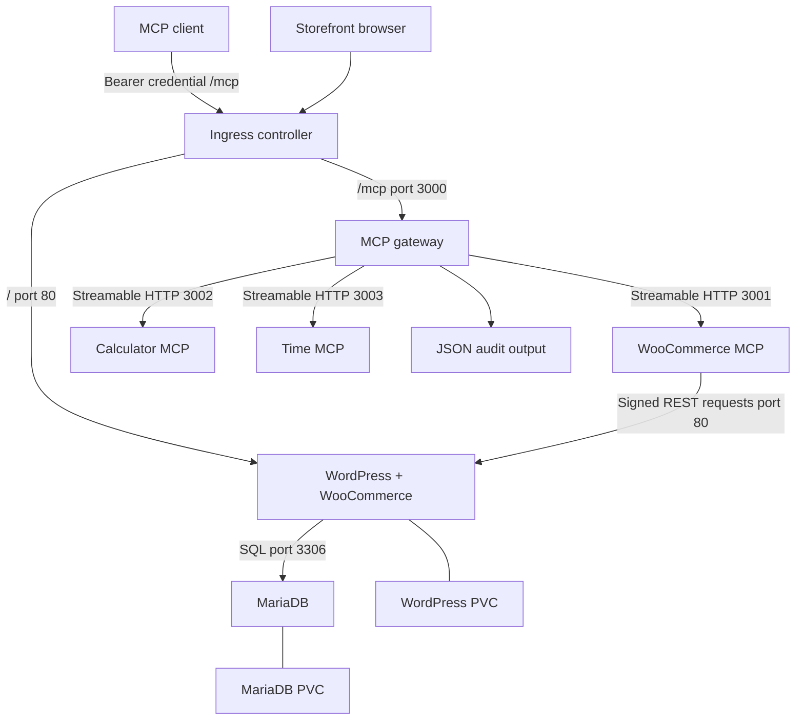
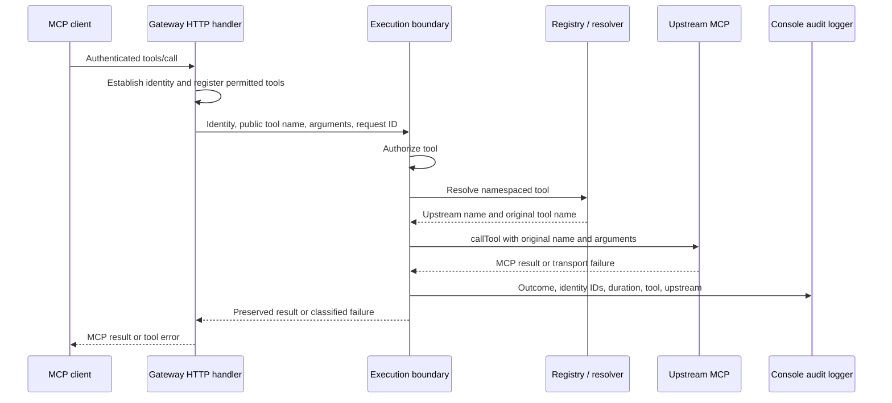

# System Design

## Scope and source baseline

Urumi is an MCP gateway and a Kubernetes-hosted WooCommerce integration. Clients use one authenticated MCP endpoint to discover and invoke tools from three upstream servers. WordPress owns storefront functionality, WooCommerce owns commerce behavior, and MariaDB stores WordPress/WooCommerce data.

This design describes [Moracus/urumi-assignment at commit `f740f55`](https://github.com/Moracus/urumi-assignment/tree/f740f557e524dd9ccf45e41014038a08a66aad92). It records implemented behavior and configuration requirements. It does not certify a running cluster or imply that the dashboard scaffold provides management features.

See [README](../README.md) for setup and validation commands.

## Component topology



The controller is installed separately from the application chart. Internal MCP endpoints and the database have ClusterIP Services and no Ingress templates. Local values select Traefik; the chart's base ingress class is `nginx`, so deployments should explicitly choose the appropriate values file and controller namespace.

| Component | Responsibility | State |
| --- | --- | --- |
| Gateway | Authenticate requests, filter discovery, authorize calls, resolve tools, invoke upstreams, emit audit records. | In-memory registry, cached schemas, MCP clients, refresh timer. |
| WooCommerce MCP | Validate tool inputs and translate commerce operations into REST API calls. | Environment-backed REST credentials; commerce data stays in WooCommerce. |
| Calculator MCP | Perform four arithmetic operations with bounded input types and result checks. | No persisted application state. |
| Time MCP | Format current time using an IANA timezone. | No persisted application state. |
| WordPress/WooCommerce | Storefront, products, orders, REST API, store administration. | MariaDB data and WordPress filesystem. |
| MariaDB | Persist WordPress and WooCommerce relational data. | PVC mounted at `/var/lib/mysql`. |
| Dashboard | React/Vite landing-page scaffold. | No implemented management backend integration. |

## Gateway initialization and discovery

`apps/gateway/src/index.ts` creates a registry and registers the WooCommerce, calculator, and time endpoints from environment variables or cluster DNS defaults. These registrations are application configuration, not a remotely editable registry.

The registry connects to all upstreams independently using `Promise.allSettled`. A failed upstream does not abort initialization of healthy ones. Each connection uses the MCP client and Streamable HTTP transport. Connection setup and tool discovery each have a five-second timeout.

An upstream becomes `connected` only after a successful `listTools` response. Its cache records the discovered tool names, descriptions, and JSON input schemas. States include `disconnected`, `connecting`, `connected`, `unreachable`, and `disabled`.

The gateway refreshes discovery every 30 seconds. A disconnected or unreachable upstream is reconnected on a subsequent refresh. Failed discovery closes the connection, marks the upstream unreachable, and preserves earlier tool definitions internally. Those cached definitions are excluded from public discovery while the upstream is unavailable.

The aggregator publishes `<upstream>.<tool>` names, such as `woocommerce.list_products` and `calculator.calculate`, sorts them predictably, and rejects duplicate public names. Identical unprefixed names from different upstreams remain distinct. Input schemas are cloned and converted through the MCP server SDK for registration.

The gateway constructs an MCP server using the current catalog and request identity. It filters out tools the identity cannot invoke. Changes appear through subsequent requests and catalog construction; the code does not implement an explicit proactive tool-list-change notification mechanism.

## Authentication and authorization

Every gateway request whose path is `/mcp` passes a Fastify authentication hook. Missing or invalid bearer credentials return HTTP 401 with `WWW-Authenticate`. Missing bootstrap configuration returns HTTP 503. The MCP handler also derives identity from the request's authorization header when constructing the server.

Authentication reads `GATEWAY_BOOTSTRAP_KEY`, hashes both the configured and supplied tokens with SHA-256, and compares equal-length digests with `timingSafeEqual`. A successful request becomes:

```json
{
  "userId": "bootstrap-admin",
  "role": "admin",
  "keyId": "bootstrap-key"
}
```

There is no current user database, team membership lookup, or client-selected identity. A bearer credential cannot select the member role. Hashing during comparison must not be confused with a persisted hashed-key store: the configured bootstrap key remains an environment-backed secret.

The authorization module permits admins to invoke all registered tools. Its member allowlist includes `woocommerce.list_products`, `woocommerce.list_orders`, `woocommerce.get_order`, `calculator.calculate`, and `time.current`. Product creation and order updates are rejected for members. Member behavior is exercised by internal tests with constructed identities.

Authorization is applied both while constructing the visible catalog and before resolving/executing a tool. This prevents an internal caller from bypassing authorization simply by naming a hidden tool. Host allowlists provide HTTP host validation; they are separate from bearer authentication and Kubernetes network controls.

## Tool execution flow



The execution boundary generates audit timing around authorization, resolution, and invocation. Its request ID is generated by the gateway tool callback, rather than copied from a client JSON-RPC ID.

The resolver maps a public name to an upstream and original name. Unknown names produce a not-found error internally. A name previously discovered on an unavailable upstream can produce an unavailable error internally; since unavailable tools are omitted from the current catalog, the SDK may reject such a public call before it reaches this resolver.

Before forwarding, the invoker checks that the upstream is enabled and connected, the original tool exists in its catalog, and the public name exactly matches the expected namespace mapping. Arguments are forwarded without adding user credentials. The client's gateway bearer token is not forwarded to upstream servers.

Upstream `callTool` has a ten-second timeout. Responses must contain a `content` array whose entries have string `type` fields. Valid MCP results are preserved, including `isError` and any `structuredContent`. A tool-level error such as division by zero is different from a broken transport and does not by itself disconnect the upstream.

For classified execution failures, the gateway callback returns a generic MCP tool error such as “Upstream server unavailable” or “Upstream request timed out.” This avoids exposing connection exceptions from the gateway. WooCommerce tool errors preserve REST status, code, and message in their result, so this is not universal redaction of upstream messages.

## Failure handling and health

Connection failures, call timeouts, failed MCP requests, and invalid response structures affect the corresponding upstream. The registry closes that connection and excludes its tools while healthy upstreams remain discoverable. Per-upstream connection maintenance is coordinated, and a failure from an older client is checked before invalidating a replacement connection.

Recovery is periodic reconnection and rediscovery, not automatic replay of the failed tool call. There is no write-idempotency mechanism. A timeout during product creation or an order update can occur after the store has applied the operation; inspect the store before retrying.

| Probe | Actual guarantee |
| --- | --- |
| Gateway `/health/live` | HTTP process responds. |
| Gateway `/health/ready` | At least one upstream is marked connected; HTTP 503 when none are. |
| Upstream `/health/live` and `/health/ready` | Process-level response; no WordPress API dependency check. |
| WordPress readiness | A static WordPress CSS asset is served, not a commerce transaction. |
| MariaDB readiness | Container health script checks connectivity and InnoDB initialization. |

Gateway readiness does not check the bootstrap credential, complete tool availability, or end-to-end WooCommerce behavior. Cached connection state can lag behind an outage until a request or discovery refresh detects it.

Fastify's gateway close hook closes the MCP handler and registry connections and clears the refresh timer. The source does not establish a broader application shutdown orchestration mechanism through explicit process signal handlers.

## WooCommerce integration

The adapter registers two product tools and three order tools with Zod input validation. Lists return selected fields and a count for the returned page; they do not expose a total record-count abstraction. Product creation supports simple products only. Order status updates are limited to four specified statuses. Order creation, deletion, inventory workflows, and refunds are not implemented tools.

The REST client targets `/wp-json/wc/v3`, signs requests with OAuth-style HMAC-SHA1 parameters, and uses fresh nonces and timestamps. Requests have a ten-second timeout and reject redirects. HTTP status failures and invalid JSON become WooCommerce errors represented as MCP tool results.

`WC_URL` is the canonical storefront URL used to calculate the signature. When `WC_INTERNAL_URL` is set, the client rewrites only the network destination's scheme, hostname, and port after signing, and supplies the canonical `Host` header. This lets the adapter reach `urumi-wordpress` directly while preserving the expected storefront host.

The site's configured canonical URL, scheme, and port must agree with the signing URL. Redirects, port mismatches, or a site forcing HTTPS while the internal hop uses HTTP can prevent successful requests; HTTPS/proxy configuration needs explicit verification when changed.

Read/write WooCommerce credentials are supplied only to the adapter through its Kubernetes Secret. WordPress installation, WooCommerce activation, store settings, payment methods, and data provisioning remain manual configuration outside the Helm templates.

## Network boundaries

The chart contains six ingress-only NetworkPolicies, enabled by default:

| Destination | Allowed source | TCP port |
| --- | --- | --- |
| Gateway | Pods in `networkPolicy.ingressNamespace` | 3000 |
| WooCommerce MCP | Same-namespace Pods labeled `app: urumi-gateway` | 3001 |
| Calculator MCP | Same-namespace Pods labeled `app: urumi-gateway` | 3002 |
| Time MCP | Same-namespace Pods labeled `app: urumi-gateway` | 3003 |
| WordPress | Controller-namespace Pods **or** same-namespace WooCommerce MCP Pods | 80 |
| MariaDB | Same-namespace WordPress Pods | 3306 |

Ports for the gateway and MCP services are configurable in values. All selected workloads remain unrestricted for egress under these policies. This is not a cluster-wide default-deny configuration for arbitrary Pods.

Controller access is selected by namespace name rather than controller Pod labels. Workload access is selected by Pod labels rather than authenticated service identity. Anyone able to create suitably labeled Pods in the application namespace may satisfy those selectors; namespace access and Kubernetes RBAC therefore remain separate requirements. Other matching allow policies can also broaden access.

NetworkPolicy enforcement depends on the cluster network plugin. ClusterIP does not imply isolation, and the supplied Kind YAML does not install an enforcing plugin. Administrative port-forwarding does not demonstrate or enforce these ordinary Pod-network boundaries.

Upstream MCP endpoints contain no bearer-authentication boundary of their own. Their intended protection is internal exposure plus enforced policies. Internal traffic uses HTTP by default, and the Ingress templates have no TLS configuration. TLS termination, upstream authentication, and egress restrictions are not current chart capabilities.

## Deployment and persistence

The Helm chart supplies one replica per backend workload, ClusterIP Services, resource requests/limits, and startup/readiness/liveness probes. WordPress and MariaDB use `Recreate` Deployments and separate 5 GiB PVCs by default. WordPress mounts `/var/www/html`; MariaDB mounts `/var/lib/mysql`.

The chart expects these pre-existing Secrets:

| Secret | Keys | Consumers |
| --- | --- | --- |
| `urumi-db-secret` | `database-password`, `root-password` | WordPress and MariaDB; root password is used by MariaDB only. |
| `urumi-woocommerce-api` | `consumer-key`, `consumer-secret` | WooCommerce MCP. |
| `urumi-gateway-auth` | `bootstrap-key` | Gateway. |

Secrets are injected as environment variables, so changes require affected Pods to restart. The chart neither creates the Secrets nor manages their rotation. Kubernetes Secret references alone do not establish encryption-at-rest, access-control, or external secret-manager guarantees.

Application Dockerfiles build the selected package from the monorepo on Node.js 24, install the frozen pnpm lockfile, and start compiled JavaScript. They copy the workspace and dependencies rather than using a separate minimal runtime build. Container-level production hardening is not provided as a complete security profile.

Resource names and default service URLs are fixed with the `urumi-` prefix; some allowed hosts include namespace `urumi`. Multiple releases in one namespace will collide without template changes. Alternate namespaces require inspecting and overriding namespace-dependent host settings.

`values-local.yaml` selects Traefik and local storefront/gateway hostnames. `values-prod.yaml` provides placeholder production domains and a storage class, but does not provision DNS, certificates, backups, a controller, or a hardened deployment. The dashboard values have no corresponding workload or Ingress implementation.

## Audit and observability

The audit logger writes JSON containing `event: tool_execution`, request ID, user ID, key ID, upstream name, tool name, timestamp, duration, and outcome. Outcomes distinguish success, tool error, unauthorized invocation, not found, unavailable upstream, timeout, and other upstream errors.

Audit records intentionally omit arguments, raw bearer tokens, WooCommerce credentials, and result bodies. An audit-write failure is reported to the server console and does not replace the tool result. There is no durable queue or fail-closed audit policy.

These records cover calls that enter the execution boundary. Failed HTTP authentication, rejected discovery, unknown tools rejected by SDK dispatch, and schema-validation errors occurring before the callback are not guaranteed execution audit records. Audit retention and collection require external log infrastructure; the repository has no persistent audit API, metrics stack, or dashboard viewer.

## Verification and remaining gaps

The repository includes unit tests for execution authorization/audit and aggregation/resolution, plus runnable registry, aggregation, routing, WooCommerce REST, and interactive failure-isolation scripts. Internal routing scripts construct identities directly and do not test public HTTP authentication. The README separates those checks from MCP-client and cluster-policy validation.

The current architecture provides a functional execution and routing boundary, but is not a complete multi-user management platform. Persisted users and team keys, key revocation, editable upstream configuration, durable audit storage, dashboard features, chat orchestration, TLS, rate limiting, egress controls, backups, and high availability are absent. Additions should update this document when their source and deployment behavior exist.
